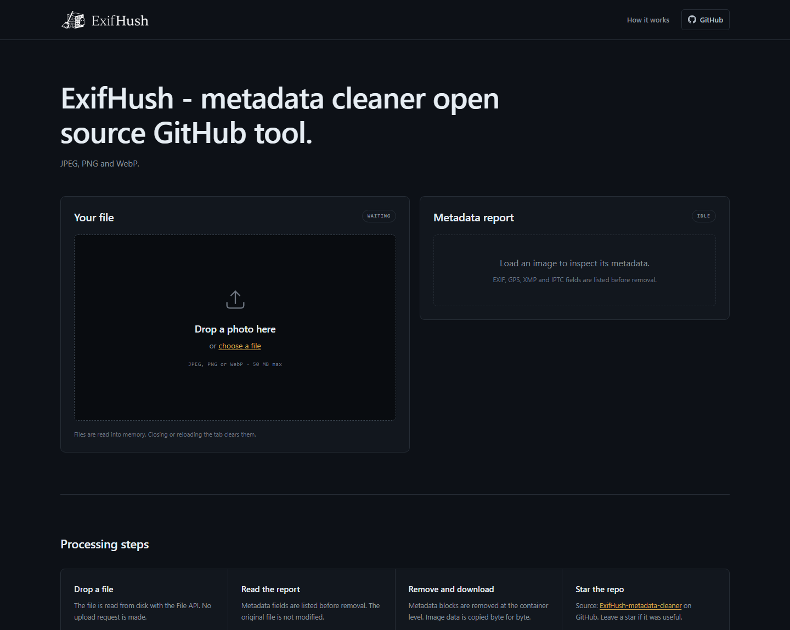
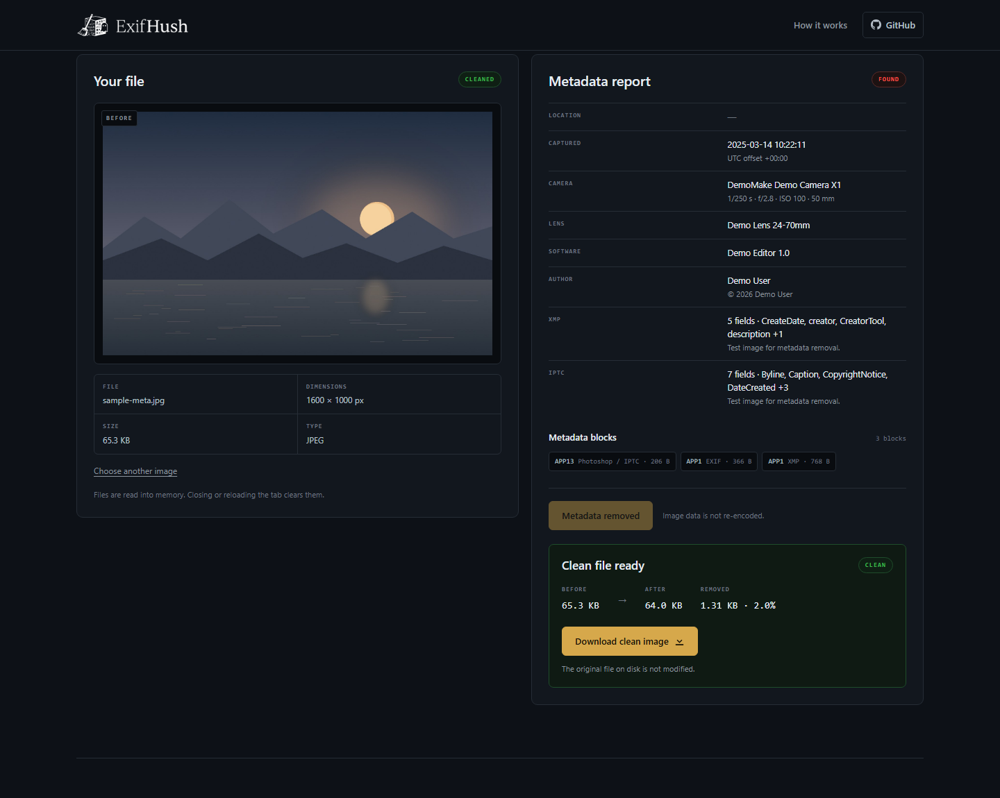

# ExifHush

Local metadata cleaner for JPEG, PNG and WebP.

ExifHush removes EXIF, GPS, XMP and IPTC metadata in the browser. Files are not uploaded. JPEG and PNG image data is copied byte for byte. WebP EXIF and XMP chunks are removed at the RIFF chunk level.

Repository: https://github.com/mrnoxxxdevvii/ExifHush-metadata-cleaner



## Supported formats

| Format | Removed | Kept |
| --- | --- | --- |
| JPEG | APP1 (EXIF/XMP), APP3-APP13 (IPTC, Photoshop, vendor blocks), APP15, COM, data after EOI | APP0, ICC, MPF, Adobe APP14, image scan data |
| PNG | `tEXt`, `zTXt`, `iTXt`, `eXIf`, `tIME`, `dSIG`, data after IEND | IHDR, PLTE, IDAT, ICC and other image chunks |
| WebP | `EXIF` and `XMP ` RIFF chunks, EXIF/XMP flags in VP8X | VP8/VP8L payload, ICC, animation and other chunks |

The ICC profile is kept so colours do not shift after removal.

## How it works

1. The file is read from disk with the File API.
2. Container segments or chunks are scanned for metadata.
3. Metadata blocks are removed without touching image data.
4. The cleaned file is offered as a download. The original is not modified.




## Verify network activity

1. Open the page in a desktop browser.
2. Press <kbd>F12</kbd> and open the **Network** tab.
3. Drop a photo and click **Remove metadata**.
4. No new request should appear after the page assets load.

The page is static HTML, CSS and JavaScript. Its Content Security Policy is:

```
default-src 'none'; img-src 'self' blob: data:; style-src 'self'; script-src 'self';
font-src 'self'; connect-src 'none'; object-src 'none'; base-uri 'none';
form-action 'none'; manifest-src 'self'; worker-src 'none'
```

`connect-src 'none'` blocks `fetch`, `XMLHttpRequest`, WebSocket and `sendBeacon`. All page assets are local. The only external URLs are GitHub links.

## Run locally

No build step and no dependencies to install.

```sh
git clone https://github.com/mrnoxxxdevvii/ExifHush-metadata-cleaner.git
cd ExifHush-metadata-cleaner
python -m http.server 8765
```

Open `http://localhost:8765/`. Any static file server works.

## Browser support

Current versions of Chrome, Edge, Firefox and Safari. The tool uses the File API, Blob URLs and `URL.createObjectURL`.

## Limitations

- HEIC and AVIF are not supported. Export the photo as JPEG first.
- Visible watermarks and date stamps are part of the image pixels. They are not removed.
- PNG and WebP chunks that are not recognised as metadata are preserved. JPEG APP segments other than APP0, ICC, MPF and Adobe are removed.
- The report shows fields understood by the bundled parser. A file can carry custom data in blocks the report does not name.
- Metadata embedded inside the compressed pixel stream (steganography) is outside the scope of this tool.

## Project layout

```
index.html                     page
assets/app.css                 styles
assets/app.js                  scanning, stripping and UI
assets/vendor/exifr.umd.js     metadata parser (exifr 7.1.3)
assets/vendor/exifr.LICENSE    parser license
assets/favicon.svg             favicon
assets/logo-*.png              logo variants
docs/screenshots/              README screenshots
```

## Credits

Metadata parsing uses [exifr](https://github.com/MikeKovarik/exifr) by Mike Kovařík. MIT licensed and vendored in `assets/vendor/`.

## License

MIT. See [LICENSE](LICENSE).

If this tool is useful, star the repo: https://github.com/mrnoxxxdevvii/ExifHush-metadata-cleaner

Built by [Mr. Nox](https://github.com/mrnoxxxdevvii).
